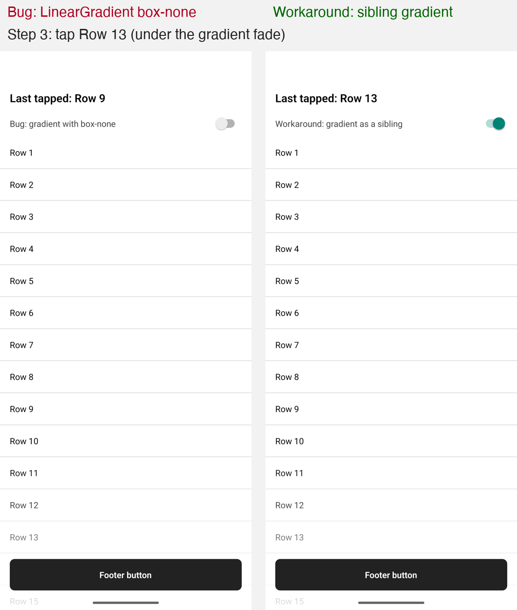
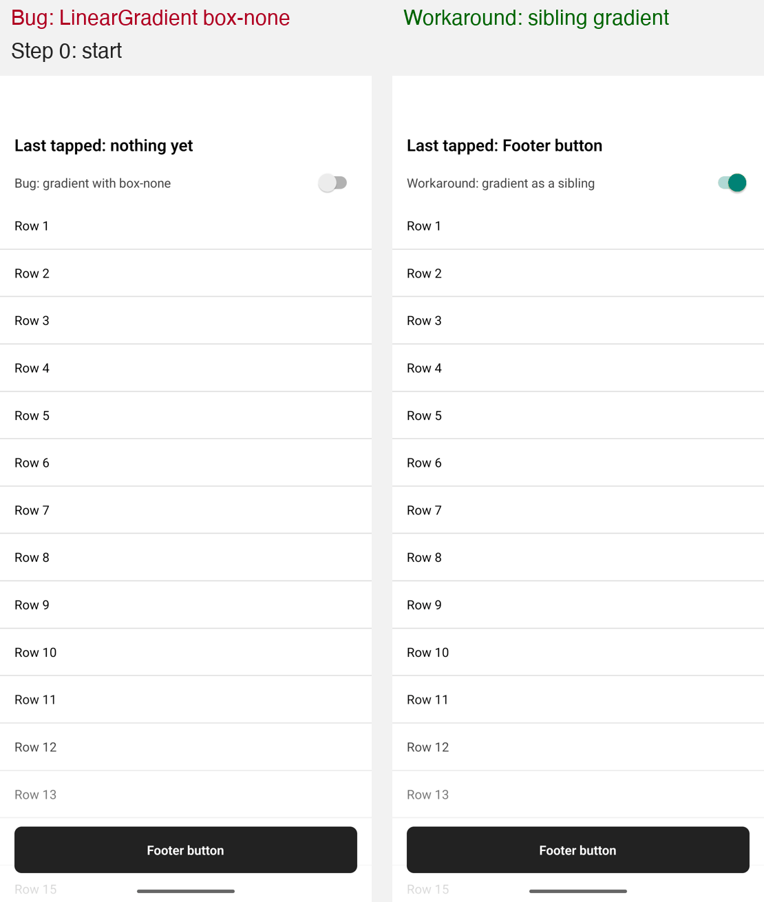

# LinearGradient with pointerEvents="box-none" swallows taps on Android

Reproduction for https://github.com/expo/expo/issues/53387 on Android.

Versions: Expo SDK 58 (`expo` 58.0.24), `expo-linear-gradient` 58.0.4, `react-native` 0.88.1, New Architecture.
Recorded on the Android emulator Medium_Phone_API_37.0, Android 17 (API 37), 11/12/26.

## Run

```sh
npm install
npx expo run:android   # development build, Android emulator or device
```

## What the screen shows

A scrollable list of 30 pressable rows and a footer pinned to the bottom. The footer is a
`LinearGradient` from transparent to white with `pointerEvents="box-none"`, 160 px of fade above a
"Footer button". The status line at the top shows the last thing that was tapped.

The switch under the status line swaps the footer between the two layouts:

| Switch | Footer |
| --- | --- |
| off (bug) | `<LinearGradient pointerEvents="box-none">` wrapping the button, as in the issue |
| on (workaround) | `<View pointerEvents="box-none">` with the gradient as a `pointerEvents="none"` sibling |

## Result

Each tap was sent with `adb shell input tap` and the status line read back from the view hierarchy.

| Tap | Expected | Bug layout | Workaround layout |
| --- | --- | --- | --- |
| Row 9, outside the gradient | Row 9 | Row 9 | Row 9 |
| Row 12, under the fade | Row 12 | **still Row 9** | Row 12 |
| Row 13, under the fade | Row 13 | **still Row 9** | Row 13 |
| Footer button | Footer button | Footer button | Footer button |
| Row 13 again | Row 13 | **still Footer button** | Row 13 |

Rows visible through the fade never receive the tap in the bug layout. Rows outside the gradient
and the gradient's own child keep working, so only `box-none` on the gradient itself is broken.
Raw tap logs: `media/bug-box-none.txt`, `media/workaround-sibling.txt`.

## Media





Screen recordings with touch indicators: `media/bug-box-none.mp4` and `media/workaround-sibling.mp4`.
Per-step screenshots: `media/bug-box-none-*.png` and `media/workaround-sibling-*.png`.
Emulator details: `media/emulator-android-version.txt`.

## Likely cause

`NativeLinearGradient.android.tsx` spreads `pointerEvents` onto a wrapper `View` and renders the
native `ExpoLinearGradient` view as a `StyleSheet.absoluteFill` child without it. The native
`LinearGradientView` extends a plain `android.view.View` and does not implement
`ReactPointerEventsView`, so React Native's touch targeting treats it as `pointerEvents="auto"`.
The native view becomes the touch target across the whole gradient and the touch never reaches
the rows behind it. iOS renders the native view directly with the props, so it is not affected.

## Workaround

Render the gradient as a sibling inside your own container, which is what the switch turns on:

```tsx
<View pointerEvents="box-none" style={footerStyle}>
  <LinearGradient pointerEvents="none" style={StyleSheet.absoluteFill} colors={colors} />
  {children}
</View>
```
